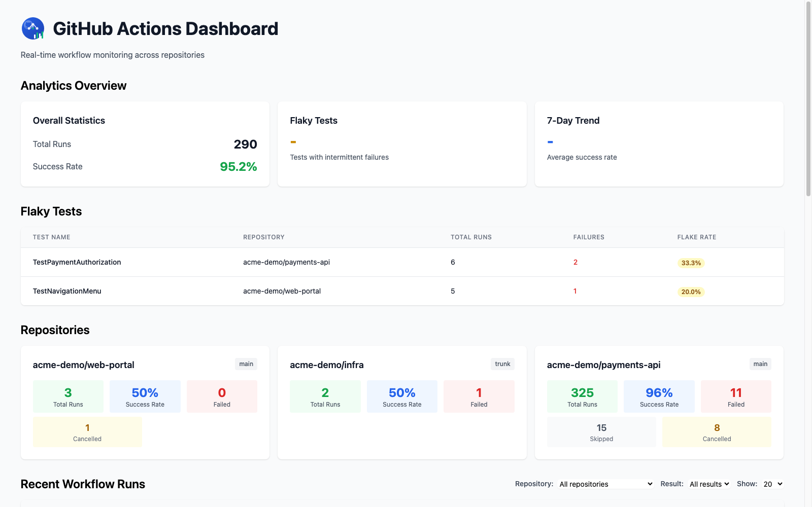
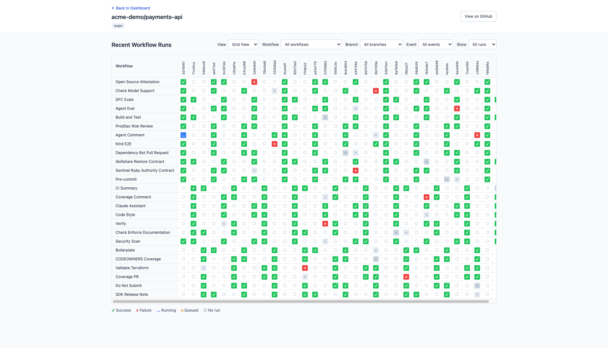

# GitHub Actions Dashboard

Monitor workflow health across repositories installed in a GitHub App. The dashboard includes aggregate analytics, flaky check detection, and a workflow-by-commit matrix with filters for workflow, branch, and event.

## Screenshots





## Local Demo

Requires Go 1.27.2 and Docker Compose.

```bash
docker compose up -d postgres
go run . -config config/demo.yml
```

Open [http://127.0.0.1:8080](http://127.0.0.1:8080). The demo seeds synthetic repositories, workflow runs, and check runs into PostgreSQL. Demo mode disables OAuth only for this profile and refuses non-loopback binds or a configured public URL. Do not use demo mode for a deployed instance.

The demo database is persistent in a Docker volume. Stop the app with `Ctrl+C`; stop PostgreSQL with `docker compose down` (the volume is retained).

## GitHub App Configuration

For real GitHub data, configure `config/local.dev.yml` or `config/production.yml` and set the GitHub App credentials:

```bash
export DASHBOARD_GITHUB_APP_INTEGRATION_ID=123456
export DASHBOARD_GITHUB_APP_PRIVATE_KEY="$(cat private-key.pem)"
export DASHBOARD_GITHUB_APP_WEBHOOK_SECRET=your-webhook-secret
export DASHBOARD_GITHUB_OAUTH_CLIENT_ID=your-client-id
export DASHBOARD_GITHUB_OAUTH_CLIENT_SECRET=your-client-secret
```

The app receives `workflow_run`, `check_run`, `installation`, and `installation_repositories` webhook events at `/api/github/hook`. User-facing dashboard routes are protected by GitHub OAuth. See [docs/AUTHENTICATION.md](docs/AUTHENTICATION.md) for the authentication flow.

Production configuration supports Cloud SQL PostgreSQL through `DASHBOARD_DATABASE_CLOUD_SQL_INSTANCE`, `DASHBOARD_DATABASE_NAME`, `DASHBOARD_DATABASE_USER`, and `DASHBOARD_DATABASE_PASSWORD`.

## Routes

- `GET /` - Repository overview and analytics
- `GET /repository/{owner}/{repo}` - Repository workflow matrix
- `GET /api/repositories` - Tracked repositories
- `GET /api/workflows` - Workflow runs
- `GET /api/analytics` - Run summary
- `GET /api/flaky-tests` - Intermittently failing checks
- `GET /api/trends` - Run trends
- `GET /api/health` - Database health
- `POST /api/github/hook` - GitHub App webhook receiver

## Development

- `make test` runs tests with the race detector.
- `make lint` runs golangci-lint.
- `make verify` checks modules, vulnerabilities, and `go vet`.
- `make ko-local` builds a local container image with ko.

CI runs these checks on pull requests and pushes to `main`. Releases use GoReleaser and include an SBOM and cosign image signature.

## License

Apache License 2.0

Configuration uses positive Go durations such as `24h` or `168h` (seven days).
An explicit `options.enable_realtime: false` disables the WebSocket endpoint.
Database-backed routes return HTTP 503 until schema initialization succeeds;
the server retries initialization using the same pool shared by webhook handlers.
Shutdown cancels initialization retries and closes realtime connections.

The dashboard renders server-generated HTML partials for HTMX requests. Realtime
updates preserve active workflow filters and refresh repository, check and
installation changes. Summary cards use the returned flaky-check count and the
actual seven-day aggregate success rate. Run frontend regression tests with
`node --test tests/dashboard.test.cjs` (Node 20 or newer).
